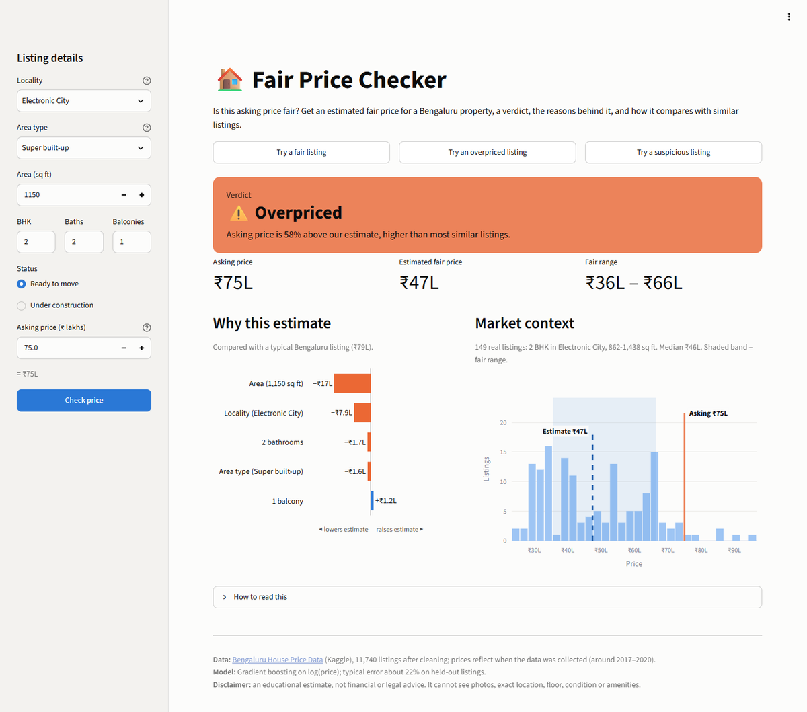
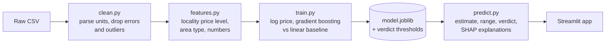
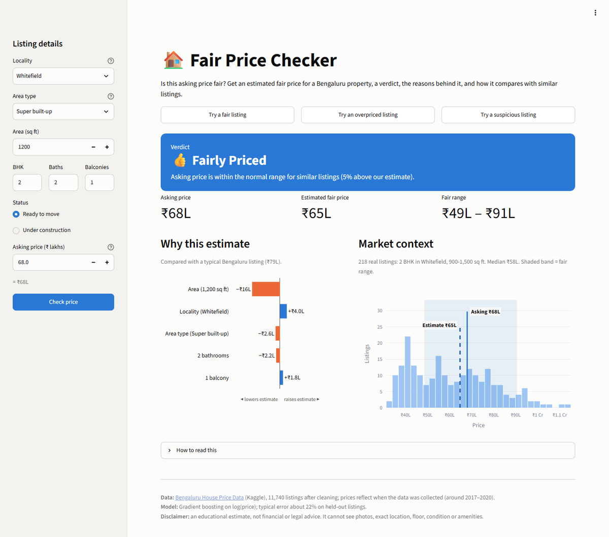
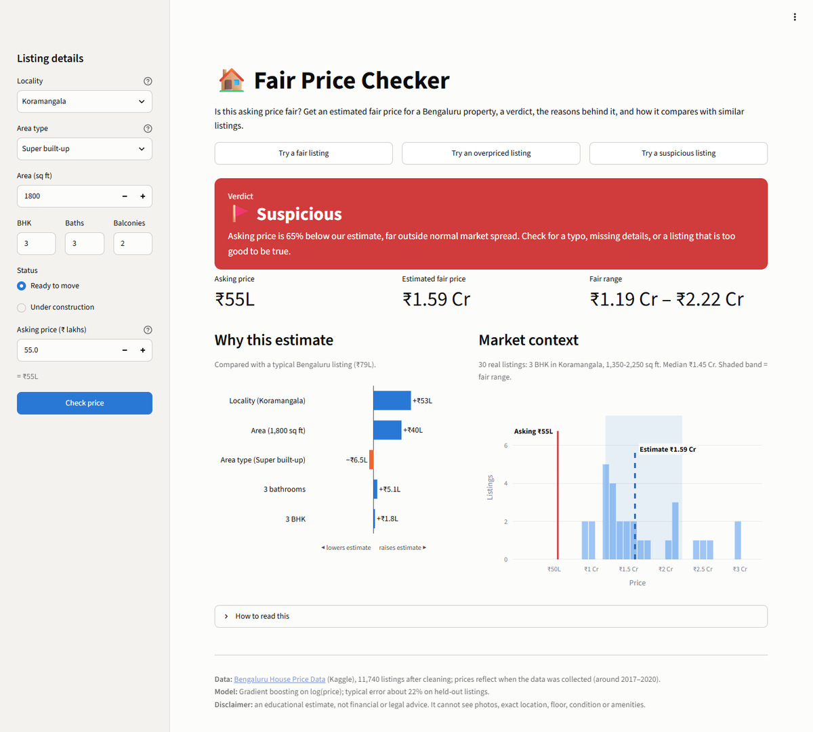

# Fair Price Checker

**Is this asking price fair?** Enter a Bengaluru property's details and its asking price. The app
estimates a fair price with a machine-learning model, gives a verdict (**Good Deal / Fairly Priced /
Overpriced / Suspicious**), explains which details pushed the estimate up or down, and shows where
the listing sits among similar real listings.



## The problem

Buyers can't easily tell whether a listing is fairly priced. Similar homes in the same area are often
listed at very different prices, and inflated or fake-looking listings are common. Fair Price Checker
gives a quick, explainable second opinion based on thousands of real listings.

The **Suspicious** verdict is the red-flag feature. When an asking price is far outside the normal
market spread (much too high, or too good to be true), the app flags it as a possible typo, missing
information or scam.

## Dataset

[Bengaluru House Price Data](https://www.kaggle.com/datasets/amitabhajoy/bengaluru-house-price-data)
(Kaggle): 13,320 listings with locality, size (BHK), total area, bathrooms, balconies, area type,
availability and price in ₹ lakhs. Prices reflect when the data was collected (around 2017–2020).

The dataset has no property age, furnishing, floor, parking or amenities, so the model can't use them.

### Cleaning ([`src/clean.py`](src/clean.py))

| Rule | Rows removed |
|---|---:|
| Exact duplicate rows | 529 |
| Missing price, area, locality, BHK or bathrooms | 74 |
| More than 10 BHK | 12 |
| Under 300 sq ft per bedroom (physically implausible) | 730 |
| Bathrooms > BHK + 2 | 9 |
| Price per sq ft outside the 1st–99th percentile (₹2,500–₹21,787) | 226 |
| **Kept** | **11,740 (88%)** |

The script also:
- turns area ranges such as `"1133 - 1384"` into their midpoint
- converts other units (square metres, square yards, acres, perch, cents, guntha, grounds) to sq ft
- fills 413 missing balcony counts with the median for that BHK

Exploration charts are in [`notebooks/01_explore.ipynb`](notebooks/01_explore.ipynb).

## Approach



- **Inputs:** locality, area type (super built-up, built-up, carpet, plot), area (sq ft), BHK,
  bathrooms, balconies, ready to move vs under construction.
- **Locality** is encoded as a single learned price level using scikit-learn's `TargetEncoder`.
  It is calculated from training data only, with cross-fitting so no listing sees its own price.
  Rare localities are shrunk toward the city average. Localities with fewer than 3 training
  listings, or that the model hasn't seen, are treated as a generic "other" locality.
- **Target:** `log(price)`. Prices are heavily skewed (skew 6.1, or 0.8 after taking the log).
  On a log scale, a ₹5L miss on a ₹40L flat counts about the same as a ₹50L miss on a ₹4 Cr villa.
- **No leakage:** price per sq ft is used only to filter outliers during cleaning, never as a model
  input, because it's calculated from the price we're predicting.
- **Split:** 70% train, 15% validation, 15% test (fixed seed), plus 5-fold cross-validation on
  train + validation.
- **Models:** linear regression (baseline), random forest, gradient boosting (main model, Huber loss).
- **Explanations:** [SHAP](https://shap.readthedocs.io/) values for each prediction, converted to
  rupees and phrased in plain words, e.g. *"Locality (Koramangala): raises the estimate by about ₹53L"*.

## Results

Error is measured on actual prices (₹ lakhs). MAPE is the average percentage error.

| Model | 5-fold CV MAPE | CV MAE | CV R² | Test MAPE | Test MAE | Test R² |
|---|---:|---:|---:|---:|---:|---:|
| Linear regression (baseline) | 22.5% | ₹25.7L | 0.76 | 22.0% | ₹25.4L | 0.81 |
| Random forest | 21.6% | ₹25.4L | 0.74 | 21.8% | ₹26.3L | 0.74 |
| **Gradient boosting (main)** | **21.9%** | **₹25.5L** | **0.75** | **22.1%** | **₹26.3L** | **0.76** |

**The main model does not clearly beat the linear baseline.**
- On cross-validation, gradient boosting is slightly better on MAPE and MAE and slightly worse on
  RMSE and R².
- On the single test split, linear regression comes out ahead.
- All of these gaps are about the size of the variation between folds.
- The reason is the data itself: price is mostly area × the locality's price level, which a linear
  model on log scales already captures. Every setup we tried landed at about 21–22% error, because
  listings with nearly identical features really are priced differently. That noise is part of the
  problem this app is about.

Gradient boosting is kept as the main model because it's slightly better on percentage error (what
the verdict uses), SHAP explains it exactly, and it's small (0.4 MB, against 11.8 MB for the random
forest).

**What drives the estimate** (average share of the SHAP effect on test listings):

| Area | Locality | Area type | Bathrooms | BHK | Balconies | Ready to move |
|---:|---:|---:|---:|---:|---:|---:|
| 58% | 16% | 10% | 9% | 3% | 3% | 2% |

## Verdict thresholds

`ratio = asking price ÷ estimated fair price`

| Verdict | Ratio | Share of real test listings |
|---|---|---:|
| 🚩 Suspicious (too cheap) | below 0.60 | |
| ✅ Good Deal | 0.60 – 0.75 | 9% |
| 👍 **Fairly Priced** | **0.75 – 1.40** | **77%** |
| ⚠️ Overpriced | 1.40 – 1.75 | 7% |
| 🚩 Suspicious (too expensive) | above 1.75 | |

Suspicious listings, at either end, make up 7% of real test listings in total.

**How the thresholds were chosen:**
- The model predicted the validation listings, and we looked at the spread of actual ÷ predicted
  prices.
- The "Fairly Priced" band runs from the 10th to the 90th percentile of that spread, so about 80% of
  real listings count as fair. "Suspicious" covers the outer 2.5% at each end.
- Values are rounded to 0.05. The rule lives in [`src/config.py`](src/config.py) and is applied
  automatically by `train.py`.
- The same 0.75–1.40 multipliers produce the **fair-price range** shown in the app, so "Fairly
  Priced" means exactly "inside the range shown".

We started from tighter default bands (fair = 0.85–1.15). With about 22% typical error, those labelled
only 46% of real listings as fair and 13% as suspicious, which is far too jumpy to trust.

## Screenshots

| Fairly Priced | Overpriced | Suspicious |
|---|---|---|
|  |  |  |

## How to run

Requires Python 3.10+ (tested on 3.13).

```bash
git clone https://github.com/advikaaaa/fair-price-checker.git && cd fair-price-checker
python -m venv .venv
# Windows: .venv\Scripts\activate     macOS/Linux: source .venv/bin/activate
pip install -r requirements.txt

python src/train.py                  # ~40 s: trains, prints metrics, saves models/model.joblib
python scripts/check_predictions.py  # optional: sanity checks (examples, bad inputs)
streamlit run app/streamlit_app.py
```

- The cleaned data (`data/processed/clean.csv`) and the trained model are included, so the app runs
  straight after `pip install`.
- To rebuild from the raw data, download `Bengaluru_House_Data.csv` from Kaggle into `data/raw/` and
  run `python src/clean.py` first.
- Tip for live demos: `?example=fair`, `?example=overpriced` or `?example=suspicious` at the end of
  the app URL opens it with that example already checked.

## Project structure

```
├── app/streamlit_app.py        UI
├── src/
│   ├── config.py               paths, cleaning rules, verdict rule, demo examples
│   ├── clean.py                load and clean raw data
│   ├── features.py             feature encoding (locality price level, area type)
│   ├── train.py                train and evaluate models, tune verdict thresholds, save
│   └── predict.py              estimate, range, verdict, SHAP explanations
├── scripts/check_predictions.py
├── notebooks/01_explore.ipynb  exploratory charts
├── data/processed/clean.csv    cleaned data (raw data is not committed)
└── models/                     model.joblib, metrics.json
```

## Limitations

- **The model only knows what's in the data.** It can't see photos, exact location within a
  locality, floor, view, condition, age, furnishing or amenities. A "Suspicious" or "Overpriced"
  flag may simply mean the listing has something the data can't capture.
- **Old prices.** The listings are from around 2017–2020, so estimates reflect that period, not
  today's market.
- **Asking prices, not sale prices.** The model learns what sellers ask, not what buyers pay, and
  there's no negotiation data.
- **Typical error is about 22%**, so the fair range is wide (−25% to +40%). The verdict is a prompt
  to look closer, not a valuation.
- **Rare localities** (fewer than 3 listings) fall back to a generic city-wide level.
- Educational project, not financial or legal advice.

## How this would scale (Big Data note)

This prototype uses pandas and scikit-learn on about 12k rows. For a nationwide feed of millions of
listings, the same pipeline maps onto Spark:

- **Ingest and clean:** Spark DataFrames, with the parsing rules as column expressions and outlier
  percentiles from `approxQuantile`. Cleaned data would be stored as partitioned Parquet (by city
  and month).
- **Features:** Spark MLlib `StringIndexer` and target encoding computed with `groupBy` aggregates,
  plus `VectorAssembler`.
- **Training:** MLlib `GBTRegressor` on `log(price)`, with `CrossValidator` for tuning. Or one model
  per city, trained in parallel.
- **Verdict thresholds:** recomputed for each city and month from residual percentiles, so the bands
  follow each market.
- **Serving:** batch-score new listings nightly, and add red-flag signals such as duplicate photos
  or descriptions across listings.

## Team

- Advika Awasthi
- Utkarsh Mallik
