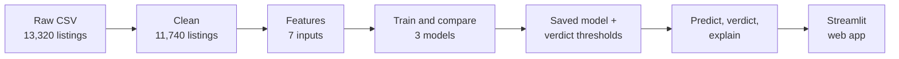

# Fair Price Checker, explained

This document walks through the whole project: what problem it solves, how each stage works, why
we made each design choice, and how to read the results. You don't need to read any code to follow
it. File links are there if you want to see the details.

**Team:** Advika Awasthi, Utkarsh Mallik
**Code:** https://github.com/advikaaaa/fair-price-checker

---

## 1. The problem

Someone browsing property listings in Bengaluru sees a 2 BHK flat in Whitefield for ₹68 lakhs. Is
that a fair price? It's hard to tell:

- Similar flats in the same area are listed at very different prices.
- A buyer can't easily compare against thousands of other listings.
- Some listings are inflated, mistyped, or too good to be true (a common pattern in scams).

**Fair Price Checker answers one question: is this asking price fair?** It does this by learning
what similar properties are listed for, then comparing the asking price with that estimate.

## 2. What the user sees

The user enters a listing's details and asking price, and gets four things back:

| Output | Example |
|---|---|
| **Estimated fair price and range** | Estimate ₹65L, fair range ₹49L – ₹91L |
| **Verdict** | 👍 Fairly Priced: "Asking price is within the normal range for similar listings (5% above our estimate)." |
| **Why this estimate** | "Area (1,200 sq ft): lowers the estimate by about ₹16L", "Locality (Whitefield): raises the estimate by about ₹4.0L", ... |
| **Market context** | A chart of 218 real 2 BHK listings in Whitefield of similar size, with the asking price and estimate marked |

There are four possible verdicts: ✅ **Good Deal**, 👍 **Fairly Priced**, ⚠️ **Overpriced**
and 🚩 **Suspicious**.

## 3. The pipeline at a glance

| Stage | File | One-line job |
|---|---|---|
| Clean | [`src/clean.py`](../src/clean.py) | Turn messy raw data into reliable numbers |
| Features | [`src/features.py`](../src/features.py) | Turn listing details into numbers the model can use |
| Train | [`src/train.py`](../src/train.py) | Train models, measure them honestly, set verdict thresholds |
| Predict | [`src/predict.py`](../src/predict.py) | Estimate, range, verdict and explanation for one listing |
| App | [`app/streamlit_app.py`](../app/streamlit_app.py) | The web page |
| Settings | [`src/config.py`](../src/config.py) | Every rule and number in one place |

---

## 4. The data

**Source:** [Bengaluru House Price Data](https://www.kaggle.com/datasets/amitabhajoy/bengaluru-house-price-data)
on Kaggle: 13,320 listings, collected around 2017–2020.

| Column | What it holds |
|---|---|
| `location` | Locality name (1,294 different ones) |
| `size` | "2 BHK", "4 Bedroom", etc. |
| `total_sqft` | Area, usually a number, sometimes a range or a different unit |
| `bath`, `balcony` | Counts |
| `area_type` | Super built-up, Built-up, Carpet or Plot |
| `availability` | "Ready To Move" or a future date (under construction) |
| `society` | Housing society name (41% missing, so not used) |
| `price` | Asking price in ₹ lakhs (1 lakh = ₹100,000; 100 lakhs = ₹1 crore) |

**What's not in the data:** property age, furnishing, floor, parking or amenities. The model can't
use what the data doesn't have.

## 5. Cleaning: making the data trustworthy

Real listing data is messy. Before training anything, [`src/clean.py`](../src/clean.py) fixes or
removes problems, and **logs how many rows each rule removes** so the cleaning is auditable.

**Parsing messy values:**
- Area ranges like `"1133 - 1384"` become the midpoint (1,258.5 sq ft).
- Other units are converted to sq ft: `"34.46Sq. Meter"` × 10.76, `"1100Sq. Yards"` × 9,
  and similarly for acres, perch, cents, guntha and grounds.
- `"2 BHK"` and `"4 Bedroom"` become the number of bedrooms.
- "Ready To Move" becomes 1; a future date (under construction) becomes 0.

**Removing bad rows:**

| Rule | Rows removed | Why |
|---|---:|---|
| Exact duplicates | 529 | The same listing counted twice would bias the model |
| Missing price, area, locality, BHK or bathrooms | 74 | Can't learn from incomplete rows |
| More than 10 BHK | 12 | Almost certainly data-entry errors |
| Under 300 sq ft per bedroom | 730 | Physically implausible: a typo or a wrong unit |
| Bathrooms > BHK + 2 | 9 | Implausible layouts |
| Price per sq ft outside the 1st–99th percentile | 226 | Extreme outliers (₹268/sq ft or ₹1.2 crore/sq ft can't be real) |

**Result:** 11,740 listings kept (88%). Missing balcony counts (413 rows) were filled with the
typical value for that BHK instead of throwing those rows away.

> **Important:** price per sq ft is used here **only to filter out impossible rows**. It's never
> given to the model as an input (see section 7).

## 6. What exploring the data told us

From [`notebooks/01_explore.ipynb`](../notebooks/01_explore.ipynb):

1. **Prices are very skewed.** The median is ₹70L, but a few listings reach ₹20 crore. That's why
   the model predicts log(price) (section 8).
2. **Area is the strongest single driver.** Area and price have a correlation of 0.84 (both on log
   scales). Even so, homes of the same size can differ about 3× in price.
3. **Locality matters a lot.** Among the busiest localities, the typical price per sq ft ranges from
   about ₹3,000 (Electronic City Phase II) to about ₹7,200 (Hebbal).
4. **Independent houses on plots cost more per sq ft** (about ₹8,700 vs about ₹5,200 for
   apartments). That's why area type is a feature.
5. **Ready-to-move vs under-construction makes almost no difference** (₹5,325 vs ₹5,302 per sq ft).

## 7. Features: what the model is allowed to see

The model gets seven inputs for each listing:

| Feature | How it's encoded |
|---|---|
| Locality | One number: the locality's learned price level (explained below) |
| Area type | Four yes/no columns (super built-up, built-up, carpet, plot) |
| Area (sq ft) | Number |
| BHK | Number |
| Bathrooms | Number |
| Balconies | Number |
| Ready to move | 1 or 0 |

### How locality is turned into a number

There are hundreds of localities, and a model needs numbers, not names. We replace each locality
with **its typical price level, learned from the training data**. This is called *target encoding*,
using scikit-learn's `TargetEncoder`. Two safeguards keep it honest:

- **Cross-fitting:** within the training data, each listing's locality value is calculated from the
  other listings only, never from its own price. Otherwise the model could "see" the answer.
- **Shrinkage:** a locality with only 3 listings gets a value pulled toward the city average,
  because 3 listings is weak evidence.

Localities with fewer than 3 training listings, and any locality the model has never seen, are
grouped as **"other"** and get a generic city-wide price level. That covers 9% of training rows;
480 localities are learned individually.

### What's deliberately *not* an input: price per sq ft

Price per sq ft = price ÷ area. If we gave the model the price per sq ft, it could just multiply by
the area and get the price back exactly. It would look perfect in testing, but it would be useless
for a new listing, because you'd need the price to calculate it. This mistake is called
**data leakage**: letting information about the answer sneak into the inputs.

## 8. The model

### Predicting log(price) instead of price

The model predicts the **logarithm** of the price, and we convert back afterwards. Why:

- Prices are very skewed (skew 6.1, or 0.8 after taking the log).
- On a log scale, *percentage* errors matter equally. Being ₹5L off on a ₹40L flat and ₹50L off on
  a ₹4 crore villa are both about 12% mistakes. Without the log, the model would focus almost
  entirely on the few expensive villas.

### Three models, compared fairly

| Model | Idea |
|---|---|
| **Linear regression** (baseline) | A simple weighted sum. Uses log(area) so area works multiplicatively |
| **Random forest** | Averages hundreds of decision trees |
| **Gradient boosting** (main) | Builds 600 small trees one after another, each correcting the previous ones' mistakes. Uses *Huber loss*, which is less thrown off by badly mispriced listings |

### How we measured them

- **Split:** 70% of listings for training (8,218), 15% for validation (1,761), 15% held back as a
  final test (1,761), using a fixed random seed so results are reproducible.
- **5-fold cross-validation:** a single test split of about 1,800 noisy listings can favour one
  model by luck. Cross-validation trains and tests 5 times on different slices and averages the
  results, which is fairer.
- **Metrics:**
  - **MAPE:** the average percentage error. This is the one users feel ("about 22% off").
  - **MAE:** the average error in ₹ lakhs.
  - **RMSE:** like MAE, but punishes big misses more.
  - **R²:** the share of price variation the model explains (1.0 would be perfect).

### Results

| Model | CV error (MAPE) | CV MAE | CV R² | Test MAPE | Test MAE | Test R² |
|---|---:|---:|---:|---:|---:|---:|
| Linear regression (baseline) | 22.5% | ₹25.7L | 0.76 | 22.0% | ₹25.4L | 0.81 |
| Random forest | 21.6% | ₹25.4L | 0.74 | 21.8% | ₹26.3L | 0.74 |
| **Gradient boosting (main)** | **21.9%** | **₹25.5L** | **0.75** | **22.1%** | **₹26.3L** | **0.76** |

### How to read these results honestly

- **All three models are roughly tied.** The differences are about as big as the variation between
  cross-validation folds. Gradient boosting doesn't clearly beat the simple baseline, and we say so.
- **Why so close?** In this data, price is mostly "area × the locality's price level", which even a
  linear model on log scales captures well. There isn't much left for a more complex model to find.
- **Why is the error about 22% no matter what?** Listings with nearly identical features really are
  priced differently, because sellers ask different amounts. Every model setup we tried landed at
  21–22%. That noise isn't a bug in the model; it's the very problem the app exists to flag.
- **Why keep gradient boosting, then?** It's slightly better on percentage error (which the verdict
  uses), it can capture combinations such as "plot *and* expensive locality", SHAP can explain it
  exactly (section 10), and the saved model is only 0.4 MB. The random forest is 11.8 MB.

### What drives the estimate overall

Averaged over the test listings, using SHAP values:

| Area | Locality | Area type | Bathrooms | BHK | Balconies | Ready to move |
|---:|---:|---:|---:|---:|---:|---:|
| 58% | 16% | 10% | 9% | 3% | 3% | 2% |

## 9. From estimate to verdict

For each listing, we calculate:

> **ratio = asking price ÷ estimated fair price**

A ratio of 1.0 means the asking price matches our estimate exactly; 1.2 means 20% above it.

### Choosing the thresholds from data, not by guessing

We had the model estimate prices for the **validation listings** (real listings it hadn't trained
on) and looked at how their actual prices compare with the estimates:

| | 2.5th pct | 10th pct | median | 90th pct | 97.5th pct |
|---|---:|---:|---:|---:|---:|
| actual ÷ estimate | about 0.60 | 0.73 | 1.00 | 1.40 | about 1.75 |

From that:
- the **middle 80%** of real listings counts as **Fairly Priced**
- the **outer 2.5% at each end** counts as **Suspicious**, because they're far outside normal spread
- the bands in between are **Good Deal** and **Overpriced**
- values are rounded to the nearest 0.05 so they're easy to state

| Verdict | Ratio | Share of real test listings |
|---|---|---:|
| 🚩 Suspicious (too cheap) | below 0.60 | |
| ✅ Good Deal | 0.60 – 0.75 | 9% |
| 👍 Fairly Priced | 0.75 – 1.40 | 77% |
| ⚠️ Overpriced | 1.40 – 1.75 | 7% |
| 🚩 Suspicious (too expensive) | above 1.75 | |

Suspicious listings, at either end, make up 7% of real test listings in total.

The **fair-price range** in the app is the estimate × 0.75 to the estimate × 1.40, the same limits.
So "Fairly Priced" means exactly "the asking price is inside the range shown".

**Why not tighter bands?** We first tried the textbook defaults (fair = 0.85–1.15). Because the
typical error is about 22%, those labelled only 46% of real listings as fair and flagged 13% as
suspicious, which would make the app cry wolf constantly.

The rule (which percentiles to use) lives in [`src/config.py`](../src/config.py), and
[`src/train.py`](../src/train.py) recalculates the actual numbers each time the model is trained.

## 10. Explaining each estimate with SHAP

A verdict is only useful if people can see *why*. We use **SHAP values** (SHapley Additive
exPlanations), a standard method from game theory for splitting a prediction fairly among the inputs.

**How it works for our model:**

1. SHAP starts from the model's **typical listing**: about **₹79L**.
2. It then gives each feature a contribution that moves the (log) estimate up or down from there.
3. These contributions **add up exactly** to the model's prediction. We checked: the difference is
   about 0.000000000000002.

**Turning contributions into rupees:** because the model works on log(price), a contribution *φ*
multiplies the price by *e^φ*. We report each factor's rupee effect as estimate × (1 − e^−φ):
roughly, "how much the estimate would change if this detail were typical instead". The app shows the
top 5 factors and skips any under ₹0.5L.

**Worked example: the "suspicious" demo listing**

Koramangala, 3 BHK, 1,800 sq ft, super built-up, ready to move, asking **₹55L**.

| Factor | Effect on the estimate |
|---|---|
| Locality (Koramangala) | raises it by about ₹53L |
| Area (1,800 sq ft) | raises it by about ₹40L |
| Area type (Super built-up) | lowers it by about ₹6.5L |
| 3 bathrooms | raises it by about ₹5.1L |
| 3 BHK | raises it by about ₹1.8L |

- **Estimate:** ₹1.59 crore. **Ratio:** 55 ÷ 159 = **0.35**, far below the 0.60 cut-off, so the
  verdict is 🚩 **Suspicious**.
- The 30 real 3 BHK listings of similar size in Koramangala have a median of ₹1.45 crore. A ₹55L
  asking price is far below all of them: too good to be true.

**One caution:** small effects can look odd. For example, "1 balcony raises the estimate by ₹1.8L"
is an honest report of what the model learned, but effects that small are mostly noise. The top two
or three factors carry the explanation.

## 11. The market-context chart

The chart shows real listings similar to the one being checked, so the user can see the verdict for
themselves. "Similar" starts narrow and widens until there are at least 10 listings:

1. Same locality, same BHK, area within ±25%
2. Same locality, same BHK
3. Same locality, any BHK
4. Same BHK anywhere in Bengaluru, area within ±15%

The chart marks the **asking price** (solid line, in the verdict's colour), the **estimate** (dashed
line), and the **fair range** (shaded band).

## 12. The web app

Built with **Streamlit**, a Python library that turns a script into a web page.

- **Sidebar form:** a searchable locality dropdown (with an "Other" option for unlisted
  localities), area type, area, BHK, bathrooms, balconies, construction status and asking price.
- **Three example buttons** fill in and check a ready-made listing in one click. These make the live
  demo smooth:

  | Button | Listing | Asking | Estimate | Ratio | Verdict |
  |---|---|---:|---:|---:|---|
  | Try a fair listing | Whitefield 2 BHK, 1,200 sq ft | ₹68L | ₹65L | 1.05 | 👍 Fairly Priced |
  | Try an overpriced listing | Electronic City 2 BHK, 1,150 sq ft | ₹75L | ₹47L | 1.58 | ⚠️ Overpriced |
  | Try a suspicious listing | Koramangala 3 BHK, 1,800 sq ft | ₹55L | ₹1.59 Cr | 0.35 | 🚩 Suspicious |

- **Prices** are shown in lakhs below ₹1 crore and in crores above.
- **Colour is never the only cue:** every verdict also has an icon and a word, for colour-blind
  users.
- **Unknown localities** don't break anything: they're treated as a generic Bengaluru locality, and
  the app says so. Locality names are matched regardless of capital letters and extra spaces.
- **Bad inputs** (zero area, blank locality name, etc.) get friendly messages instead of errors.
  Unusual inputs (e.g. a 500 sq ft 3 BHK) get a warning.
- **The model loads once** and is reused for every visitor, so checks are instant.
- **Direct links:** adding `?example=fair`, `?example=overpriced` or `?example=suspicious` to the
  app's address opens it with that example already checked.

## 13. How we checked it works

- [`scripts/check_predictions.py`](../scripts/check_predictions.py) runs 20 automatic checks:
  - the three example buttons give the right verdicts
  - prices across all bands give the expected verdicts
  - explanations appear for different property types
  - unknown localities fall back gracefully
  - bad inputs raise friendly errors

  All 20 pass.
- **The app was tested** with Streamlit's built-in test runner (clicking every button) and in a real
  browser at desktop and phone widths.
- **Fresh-install test:** we cloned the repository into an empty folder, installed only
  `requirements.txt`, retrained and ran the app. Everything worked.
- **Reproducible:** retraining with the fixed random seed produces an identical model file.

## 14. Limitations

- **The model only knows what's in the data.** It can't see photos, exact location within a
  locality, floor, view, age, condition, furnishing or amenities. An "Overpriced" or "Suspicious"
  flag might simply mean the listing has something the data can't capture, such as a penthouse or a
  brand-new building.
- **Old prices.** The data is from around 2017–2020, so the estimates reflect that market, not
  today's.
- **Asking prices, not sale prices.** The model learns what sellers ask, not what buyers end up
  paying.
- **About 22% typical error**, so the fair range is wide. The verdict is a prompt to look closer,
  not a valuation.
- Educational project, not financial advice.

## 15. How this would scale (the Big Data angle)

This version handles about 12,000 listings with pandas and scikit-learn on one laptop. For millions
of listings across many cities, each stage maps onto **Apache Spark**:

| Stage | Here | At scale |
|---|---|---|
| Storage | One CSV | Parquet files partitioned by city and month |
| Cleaning | pandas | Spark DataFrames; percentiles via `approxQuantile` |
| Locality encoding | `TargetEncoder` | `groupBy` aggregates joined back to listings |
| Model | scikit-learn gradient boosting | Spark MLlib `GBTRegressor` with `CrossValidator`, or one model per city in parallel |
| Verdict bands | Recalculated at each training run | Recalculated per city and month, so they follow each market |
| Serving | Live app | Plus nightly batch scoring of all new listings, and extra red flags such as duplicate photos or descriptions |

## 16. Glossary

| Term | Meaning |
|---|---|
| **BHK** | Bedroom, Hall, Kitchen. "2 BHK" = two bedrooms |
| **Lakh / crore** | ₹1 lakh = ₹100,000; ₹1 crore = 100 lakhs = ₹10 million |
| **Super built-up area** | Flat area plus a share of common areas (lobby, stairs). Usually the largest of the area figures |
| **Data leakage** | Letting information about the answer into the model's inputs, which gives fake-good test results |
| **Target encoding** | Replacing a category (like a locality) with the average target value (price level) for that category |
| **Cross-validation** | Training and testing several times on different slices of the data, then averaging, for a fairer score |
| **MAPE** | Mean absolute percentage error: on average, how many percent the estimate is off |
| **R²** | The share of price variation the model explains (1.0 = perfect, 0 = no better than guessing the average) |
| **Gradient boosting** | Many small decision trees built in sequence, each fixing the previous ones' errors |
| **SHAP** | A method that splits one prediction into contributions from each input, which add up exactly |
| **Percentile** | The value below which a given share of the data falls. The 90th percentile is higher than 90% of values |
