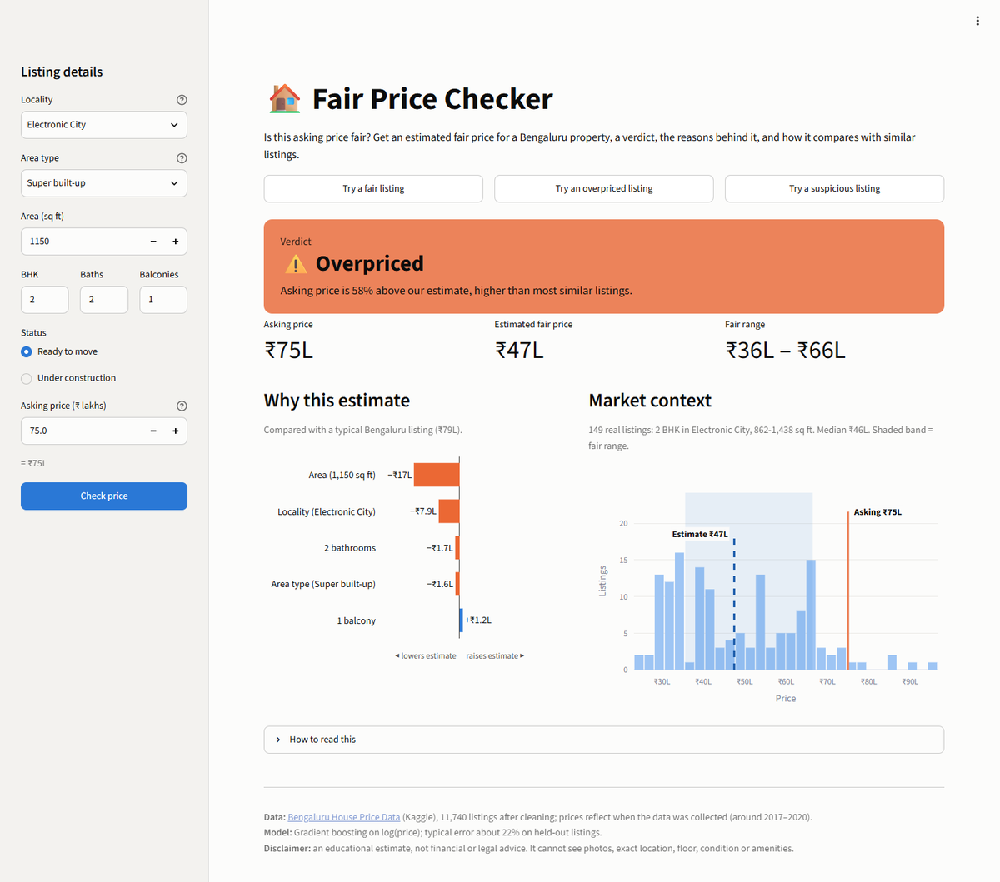

# Fair Price Checker

**Is this asking price fair?** A web app that checks whether a Bengaluru property listing is priced
fairly, using a machine-learning model trained on real listings.

- **Live app:** https://fair-price-checker.streamlit.app
- **Code:** https://github.com/advikaaaa/fair-price-checker
- **Team:** Advika Awasthi, Utkarsh Mallik
- **Course:** Big Data Analytics, class hackathon

## What it does

Enter a property's locality, area, BHK, bathrooms, balconies, area type, construction status and
asking price. The app returns:

1. **An estimated fair price**, with a fair-price range.
2. **A verdict:** ✅ Good Deal, 👍 Fairly Priced, ⚠️ Overpriced or 🚩 Suspicious. "Suspicious" means
   the price is so far from normal that it could be a typo, missing information, or a listing that's
   too good to be true.
3. **Why:** the details that pushed the estimate up or down, in rupees, e.g. *"Locality
   (Koramangala): raises the estimate by about ₹53L"*.
4. **Market context:** a chart of similar real listings, with the asking price and the estimate
   marked on it.

## How to use it

1. Open the live app.
2. Click **Try a fair listing**, **Try an overpriced listing** or **Try a suspicious listing** to see
   each kind of verdict.
3. To check your own listing, fill in the details in the left sidebar and click **Check price**.
   On a phone, open the sidebar with the **»** icon at the top left.
4. Open **How to read this** at the bottom for what each verdict means.

## How it works

| Step | What we did |
|---|---|
| Data | 13,320 Bengaluru listings from [Kaggle](https://www.kaggle.com/datasets/amitabhajoy/bengaluru-house-price-data), cleaned to 11,740: removed duplicates and impossible values, converted mixed area units, removed extreme price-per-sq-ft outliers |
| Features | Locality (learned as a price level from training data only), area, BHK, bathrooms, balconies, area type, ready to move vs under construction |
| Model | Gradient boosting on log(price), compared with a linear-regression baseline and a random forest |
| Verdict | Asking price ÷ estimate, with bands set so that about 80% of real listings count as "Fairly Priced" |
| Explanations | SHAP values for each prediction, converted to rupees and written in plain words |

## Results

- **Typical error is about 22%**, which is how far the estimate usually is from a real asking price.
  Listings with nearly identical features are often priced very differently, and that's the problem
  this app is about.
- **Our main model is roughly tied with a simple linear baseline** (21.9% vs 22.5% average error on
  cross-validation). We kept gradient boosting because it's slightly better on percentage error,
  its predictions can be explained exactly, and the model file is small.
- **What drives the estimate:** area (58%), locality (16%), area type (10%), bathrooms (9%), and
  everything else (7%).
- **On real listings the model had never seen:** 77% are Fairly Priced, 9% Good Deal, 7%
  Overpriced and 7% Suspicious.

| Verdict | Asking ÷ estimate |
|---|---|
| 🚩 Suspicious | below 0.60 or above 1.75 |
| ✅ Good Deal | 0.60 – 0.75 |
| 👍 Fairly Priced | 0.75 – 1.40 |
| ⚠️ Overpriced | 1.40 – 1.75 |

## Limitations

- The model can't see photos, exact location, floor, age, condition or amenities.
- Prices come from around 2017–2020, so the estimates reflect that period, not today's market.
- It learns from asking prices, not final sale prices.
- It's an educational estimate, not financial advice.

## How it would scale

The same pipeline maps onto Spark for millions of listings:
- cleaning with Spark DataFrames, stored as partitioned Parquet
- features and a gradient-boosted model with Spark MLlib
- verdict bands recalculated for each city and month
- nightly batch scoring of new listings

The full write-up is in the [README](https://github.com/advikaaaa/fair-price-checker#readme).
